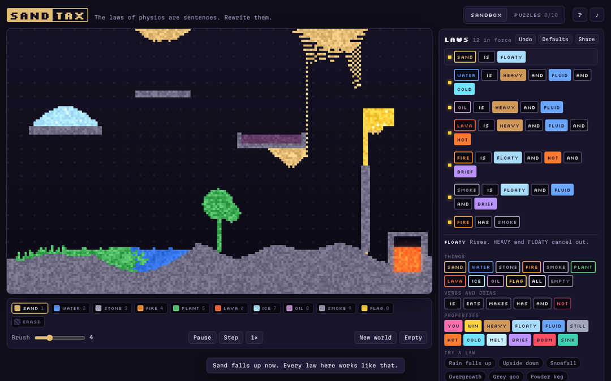
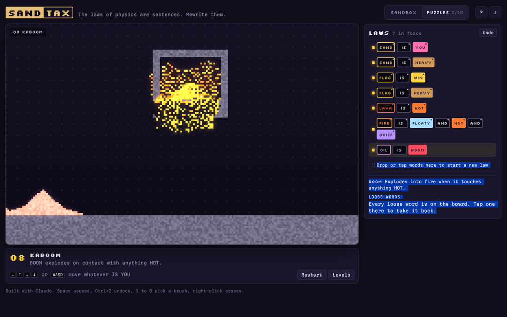

# SANDTAX

**물리법칙이 문장으로 쓰여 있는 falling-sand 세계.** 문장을 고치면 세계가 바로 바뀐다.



이 세계에는 내장 물리가 없다. 모래가 떨어지는 이유는 화면 오른쪽에 `SAND IS HEAVY`라는 문장이 있기 때문이고, 그 문장을 지우면 모래는 공중에 멈춘다. 불이 번지는 것도(`FIRE EATS PLANT`), 용암이 식어 돌이 되는 것도(`LAVA HAS STONE`) 전부 눈에 보이는 단어 타일이다. 시뮬레이션이 돌아가는 동안 타일을 끌어다 놓으면 그 즉시 법칙이 바뀐다.

## 실행

`index.html`을 브라우저로 열면 끝. 서버, 빌드, API 키 모두 필요 없다. 파일 하나(약 100KB)에 다 들어 있다.

## 문법

| 형태 | 예 | 뜻 |
|---|---|---|
| 물질 `IS` 속성 | `LAVA IS HOT` | 속성 부여 |
| 물질 `IS` 물질 | `WATER IS SAND` | 변신 (`A IS B` + `B IS A`면 한 번 맞바뀜) |
| 물질 `EATS` 물질 | `FIRE EATS PLANT` | 닿은 대상을 자기로 바꿈 (전염) |
| 물질 `MAKES` 물질 | `LAVA MAKES SMOKE` | 옆 빈칸에 계속 생성 |
| 물질 `HAS` 물질 | `ICE HAS WATER` | 파괴되면 남기는 것 |
| `AND`, `NOT` | `SAND AND ICE IS HOT AND NOT HEAVY` | 연결, 부정 |

- **물질 12개**: SAND WATER STONE FIRE SMOKE PLANT LAVA ICE OIL FLAG + `ALL`(전부) + `EMPTY`(빈 공간)
- **속성 12개**: YOU WIN HEAVY FLOATY FLUID STILL HOT COLD MELT BRIEF BOOM SINK
- `X IS YOU`면 그 물질 전체를 방향키/WASD로 조종한다. YOU가 WIN에 닿으면 승리.

## 모드

- **Sandbox**: 브러시로 물질을 칠하고 법칙을 자유롭게 편집. "Try a law" 레시피 8개(Rain falls up, Upside down, Powder keg 등). Share는 법칙 세트를 `r_...` 코드로 만들어 주고, 이 코드는 URL `#` 뒤에 붙여도 된다.
- **Puzzles**: 10레벨. 잠긴 단어(점 표시)는 못 움직이지만, 그 사이에 단어를 끼워 넣을 수는 있다(`SAND IS HEAVY` → `SAND IS NOT HEAVY`).



## 조작

| 키 | 동작 |
|---|---|
| 방향키 / WASD | YOU 조종 |
| Space / `.` | 일시정지 / 한 틱 진행 |
| Ctrl+Z | 법칙 편집 되돌리기 |
| R | 퍼즐 재시작 |
| 1~0, `[` `]` | 브러시 선택, 크기 |
| 우클릭 | 지우개 |

모바일에서는 탭으로 단어를 추가/삭제하고, YOU가 있을 때 화면 아래에 방향 패드가 나온다.

## 구조

```
src/engine.js   시뮬레이션 + 문장 파서/컴파일러 (브라우저/Node 공용, 의존성 없음)
src/levels.js   퍼즐 10개, 기본 법칙, 샌드박스 지형, 레시피
src/app.js      렌더링, 드래그 앤 드롭 보드, 브러시, 사운드(WebAudio), 퍼즐 진행
src/style.css   스타일
src/body.html   마크업
scripts/build.mjs  src/를 index.html 한 파일로 인라인
test/run.mjs    파서/의미론 테스트 + 모든 퍼즐의 풀이 검증 + 성능
test/e2e.mjs    Chromium으로 실제 UI 조작 (탭, 드래그, 퍼즐 클리어, 모바일 레이아웃)
```

```
npm run build      # src/ -> index.html
npm test           # 엔진 + 퍼즐 검증
npm run test:e2e   # 브라우저 스모크 테스트 (Playwright 필요)
```

`test/run.mjs`는 퍼즐마다 세 가지를 확인한다. (1) 법칙을 안 바꾸면 여러 입력 패턴으로도 못 깬다. (2) 레퍼런스 풀이가 시드 3개에서 모두 이긴다. (3) 그 풀이가 레벨이 준 단어만 쓰고 잠긴 문장의 순서를 깨지 않는다.

## 왜 이걸 만들었나

Sonnet 5.5 서브에이전트가 2025년 말~2026년 10월에 화제가 된 Claude 제작 프로젝트들을 조사했다. 정리하면 이렇다.

- **잘 퍼진 것**: 10초 영상이나 링크 하나로 바로 이해되는 것(stillwet.art, opusfived.dev), 과정 자체가 볼거리인 것(장시간 무인 루프, 리플레이), 익숙한 IP끼리 부딪히는 것(게임 매시업, peon-ping), 직접 해보고 검증할 수 있는 단일 파일 HTML.
- **포화된 것**: 원샷 마인크래프트/Three.js 클론, falling-sand·Lenia 데모, Claude Code 메모리/스킬 도구.
- **빈자리**: falling-sand와 Baba Is You식 규칙 재작성은 각각 흔하지만 둘을 합친 사례는 웹, GitHub, HN 검색에서 나오지 않았다. 다만 검색으로 "없음"을 증명할 수는 없다.

그래서 포화된 장르(falling sand)에 아직 아무도 안 붙인 축(법칙 = 편집 가능한 문장)을 붙였다. 숨겨진 물리 없이 화면의 문장이 곧 엔진이라는 점이 핵심이다.
